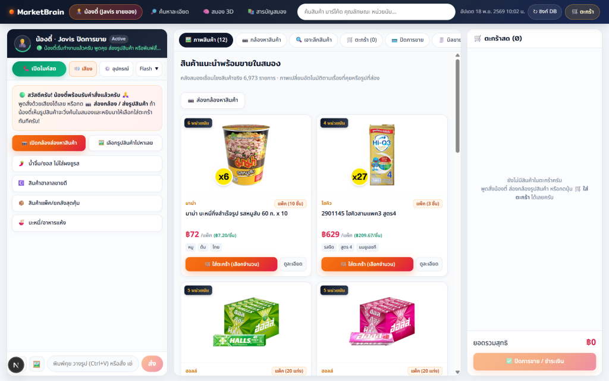
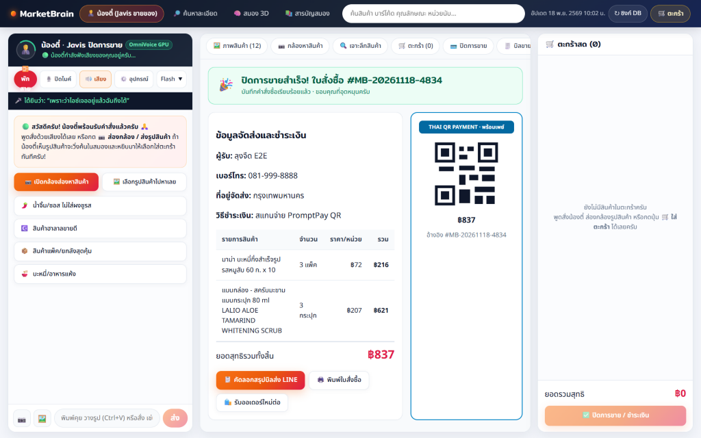
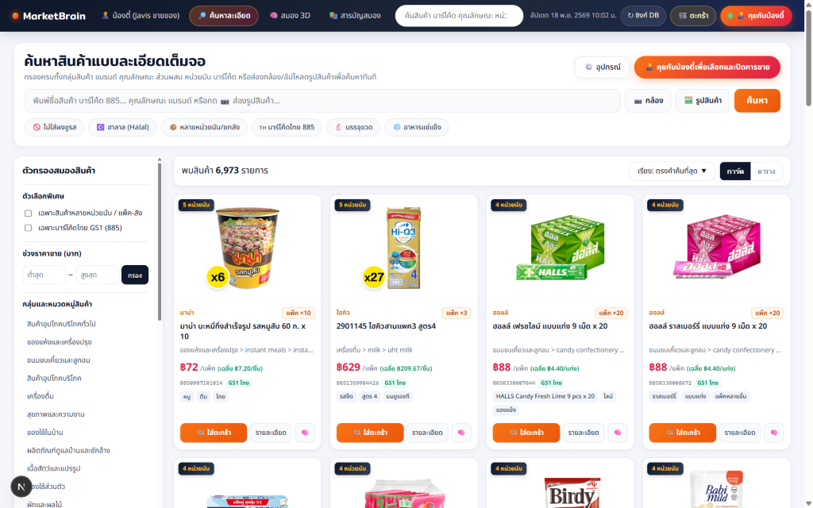
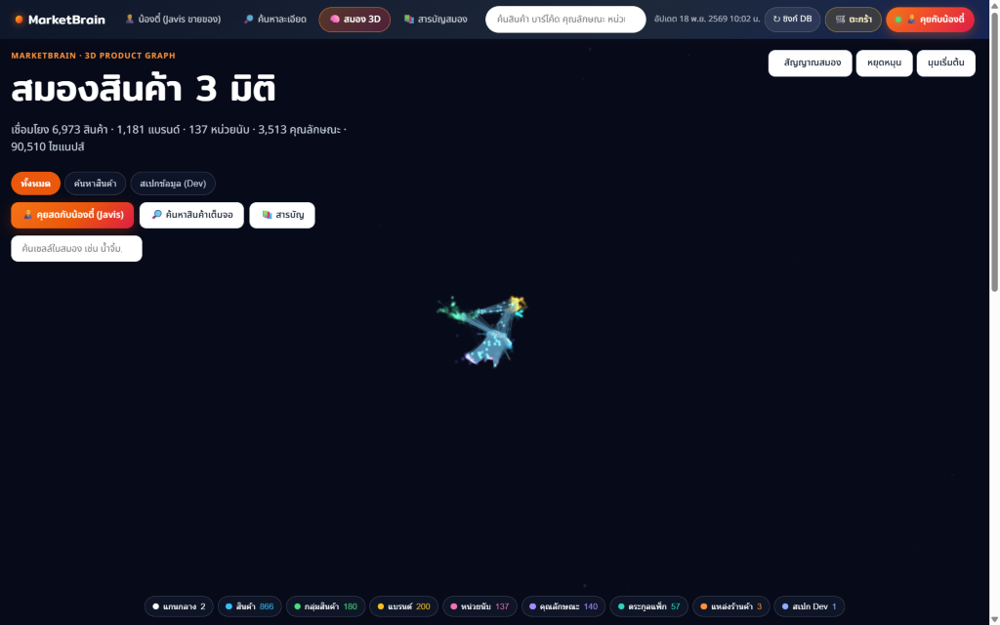
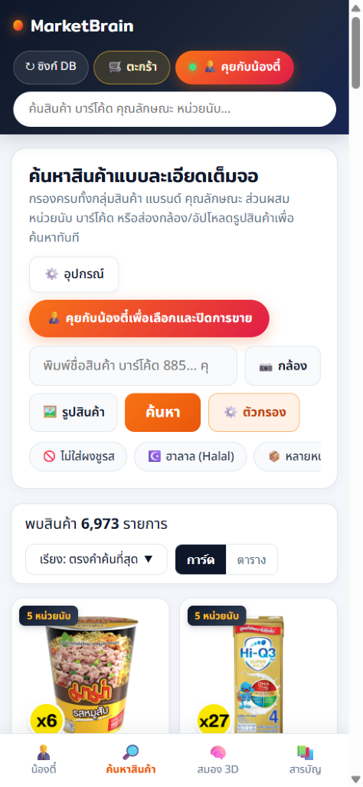
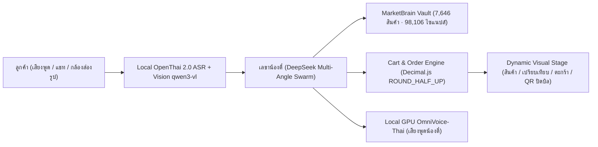

# MarketBrain — สมองสินค้าไทย & เลขาน้องตี๋ (Javis Sales Concierge)

🌐 **ใช้งานจริงออนไลน์**: [https://marketbrain.bcsmethai.com](https://marketbrain.bcsmethai.com)  
🔌 **MCP Endpoint (JSON-RPC 2.0)**: `https://marketbrain.bcsmethai.com/mcp`



## Objective
สร้างระบบสมองความรู้สินค้า (**3D Product Knowledge Graph + Hybrid BM25/Synapse GraphRAG + Faceted Search + MCP Server**) ผสานห้องสนทนาปิดการขายอัจฉริยะ (**Javis "น้องตี๋"**) สำหรับค้นหา เปรียบเทียบ ส่องรูปสินค้า จัดตะกร้า และออกใบสั่งซื้อครบวงจร โดยเชื่อมข้อมูลสินค้าจริงในตลาดค้าส่ง-ค้าปลีกไทยแบบ **Read-Only** (`7,646` รายการ, `144` หน่วยนับ, `98,106` ไซแนปส์) ขับเคลื่อนด้วย **DeepSeek**, เสียงพูดภาษาไทยโคลนในเครื่อง (**Local GPU `hotdogs/omnivoice-thai`**), ระบบฟังเสียงสด (**Local CPU `OpenThai 2.0 ASR Streaming`**) และระบบส่องค้นหาจากภาพสินค้า (**Local Vision `qwen3-vl:8b-instruct` + BarcodeDetector**) บนสถาปัตยกรรม **Next.js Mobile-First** และคำนวณเงินทุกบรรทัดด้วย `Decimal.js` (`ROUND_HALF_UP`)

---

## ภาพหน้าจอระบบจริง (Screenshots)

### 1. ห้องสนทนาปิดการขายกับ "น้องตี๋" และใบสรุปคำสั่งซื้อพร้อม PromptPay QR (`/`)
เมื่อสั่งซื้อหรือกดยืนยันปิดการขาย เวทีกลางจะสลับแสดงใบยืนยันคำสั่งซื้อเลขที่ `#MB-YYYYMMDD-XXXX` พร้อมตารางแจกแจงรายการคำนวณด้วย `Decimal.js` และคิวอาร์โค้ดพร้อมเพย์ทันที



### 2. หน้าค้นหาสินค้าแบบละเอียดเต็มความกว้างหน้าจอ (`/search`)
กางเต็มความกว้างหน้าจอ 100% เห็นรายการสินค้าหนาแน่นชัดเจน กรองได้ตามหมวดหมู่หลายระดับ แบรนด์ หน่วยนับ คุณลักษณะ (เช่น *ไม่ใส่ผงชูรส*, *ฮาลาล*) ช่วงราคา บาร์โค้ดไทย `885` พร้อมปุ่มส่องกล้อง/อัปโหลดรูปสินค้าและปุ่ม **`🛒 ใส่ตะกร้า`** ที่เด้งเลือกจำนวนและหน่วยบรรจุได้ทันที



### 3. แผนภาพสมองสินค้า 3 มิติ (`/brain`) และมุมมองมือถือ Mobile-First (`390×844`)
สำรวจโครงข่ายเซลล์ความรู้สินค้า 9 กลุ่มและไซแนปส์เชื่อมโยง 16 ชนิดในรูปแบบ 3D Interactive พร้อมรองรับการใช้งานบนสมาร์ตโฟนด้วยแถบเมนูด้านล่างเต็มรูปแบบ

| แผนภาพสมองสินค้า 3 มิติ (`/brain`) | มุมมองสมาร์ตโฟน Mobile-First (`390×844`) |
| --- | --- |
|  |  |

---

## Workflow



1. **เปิดเว็บมา น้องตี๋เริ่มทำงานทันที (`/`)**:
   - เปิดรับเสียงพูดภาษาไทยสดอัตโนมัติ (รองรับการพูดแทรก Barge-in และการกดปิดไมค์ชั่วคราวโดยสายไม่หลุด) พร้อมทักทายด้วยเสียงโคลนภาษาไทย `OmniVoice` บน GPU
   - กดปุ่ม **`⚙️ อุปกรณ์`** เพื่อเลือก **ไมโครโฟน** (พร้อมแถบวัดระดับเสียงสด), **ลำโพง/หูฟัง** (`setSinkId` + ปุ่มทดสอบเสียง) และ **กล้องส่องสินค้า**
2. **ถ้ามีรูปสินค้า ไปหาเลย (Instant Visual Product Lookup)**:
   - รองรับทั้งเปิดกล้องส่องสด (โหมด **`👁️ เจอสินค้าแล้วค้นหาเลยอัตโนมัติ`**), อัปโหลดไฟล์รูป, ลากวาง หรือกด `Ctrl+V` วางรูปภาพบนหน้าเว็บ
   - ระบบอ่านบาร์โค้ดและฉลากด้วย `BarcodeDetector` + Local Vision `qwen3-vl:8b-instruct` จับคู่สินค้าจริงในสมอง เปลี่ยนภาพบนเวที และให้น้องตี๋แจ้งราคาพร้อมเสนอหยิบใส่ตะกร้าทันที
3. **จัดการตะกร้าสดและปิดการขายครบวงจร**:
   - สั่งด้วยเสียง/แชท (*"เอาไฮคิว 4 กล่อง"*, *"เปลี่ยนเป็น 6 กล่อง"*, *"ดูตะกร้า"*, *"ปิดบิลเลย"*) หรือกดปุ่ม **`🛒 ใส่ตะกร้า`** ในคำตอบและการ์ดสินค้าเพื่อระบุจำนวนและหน่วยนับ
   - คำนวณยอดรวมทุกบรรทัดด้วย `Decimal.js` (`ROUND_HALF_UP`) และออกใบสั่งซื้อพร้อม QR พร้อมเพย์ทันที
4. **ค้นหาละเอียดเต็มจอ (`/search`) · สมอง 3D (`/brain`) · MCP Server (`/mcp`)**:
   - รองรับการค้นหาเชิงลึกและการเชื่อมต่อจาก AI ภายนอกผ่าน Streamable HTTP MCP (`ask_brain`, `search_brain`, `traverse_brain`, `read_note`, `list_notes`, `find_media`)

---

## Config
คัดลอกไฟล์ `.env.example` เป็น `.env.local` แล้วกำหนดค่าดังนี้:

| ตัวแปรสภาพแวดล้อม | คำอธิบาย |
| --- | --- |
| `MONGODB_URI` | URI เชื่อมต่อฐานข้อมูลสินค้าต้นทางแบบ Read-Only |
| `MONGODB_DB` | ชื่อฐานข้อมูลสินค้า (ค่าเริ่มต้น `bcscanproduct`) |
| `DEEPSEEK_API_KEY` | API Key สำหรับเรียกโมเดล `deepseek-flash` / `deepseek-v4-pro` |
| `DEEPSEEK_BASE_URL` | Endpoint ของ DeepSeek API (ค่าเริ่มต้น `https://api.deepseek.com`) |
| `LOCAL_VOICE_URL` | URL ของบริการเสียงในเครื่อง (ค่าเริ่มต้น `http://127.0.0.1:3091`) |
| `OLLAMA_BASE_URL` | URL ของ Local Ollama สำหรับส่องรูปสินค้า (ค่าเริ่มต้น `http://127.0.0.1:11434`) |
| `VISION_MODEL` | ชื่อโมเดล Vision ในเครื่อง (ค่าเริ่มต้น `qwen3-vl:8b-instruct`) |
| `NEXT_PUBLIC_SITE_URL` | URL สาธารณะของระบบ (ค่าเริ่มต้น `https://marketbrain.bcsmethai.com`) |

---

## Dependency
- **Frontend & Server Runtime**: Node.js >= 22, Next.js 16 (App Router), React 19, TypeScript, `decimal.js`, `three`, `marked`, `mongodb`, `@modelcontextprotocol/sdk`, `zod`
- **Local Voice & Vision AI**:
  - Python 3.11+ พร้อม PyTorch CUDA, `omnivoice` (`hotdogs/omnivoice-thai`), `onnxruntime` (`iapp/OpenThai2.0-ASR-Streaming-ONNX`), `librosa`, `soundfile`, `fastapi`, `uvicorn`
  - Ollama ในเครื่องที่โหลดโมเดล `qwen3-vl:8b-instruct`

---

## Usage Example

```bash
# 1. ติดตั้งแพ็กเกจและซิงก์ข้อมูลสมองสินค้าแบบ Read-Only
npm install
npm run sync

# 2. ตรวจสอบความลับ (Secret Scan), ชนิดข้อมูล และสร้าง Production Build
npm run scan
npm run typecheck
npm run build

# 3. รันระบบครบชุด (Local GPU OmniVoice :3091 + Next.js Production :3090 + Reverse SSH Tunnel)
node deploy/run-all.mjs

# 4. รันชุดทดสอบ Unit Selftest และ UAT + E2E ครบทั้ง 6 หมวด
npm test
npm run uat
```

ตัวอย่างการเรียกใช้งาน MCP Server (`/mcp`) ด้วย `curl`:
```bash
curl -sS https://marketbrain.bcsmethai.com/mcp \
  -H "Content-Type: application/json" \
  -H "Accept: application/json, text/event-stream" \
  -d '{"jsonrpc":"2.0","id":1,"method":"tools/call","params":{"name":"search_brain","arguments":{"query":"ไม่ใส่ผงชูรส","limit":5}}}'
```

---

## Limitation
- การเชื่อมต่อฐานข้อมูลต้นทางทำงานแบบ **Read-Only (`secondaryPreferred`)** เท่านั้น ไม่มีการเขียนแก้ไขข้อมูลกลับไปยังระบบต้นทาง กดปุ่ม **↻ ซิงก์ DB** เพื่ออัปเดตแคชสมองสินค้าได้ตลอดเวลา
- ระบบเสียงโคลน `OmniVoice` (~3.4 GB VRAM) และระบบส่องภาพ `qwen3-vl:8b-instruct` (~5.8 GB VRAM) ประมวลผลบนการ์ดจอของเครื่องโฮสต์ หากไม่ได้เปิดบริการเสริมด้านเสียง ระบบค้นหา แชท ตะกร้าสินค้า และการปิดการขายทั้งหมดยังทำงานได้ตามปกติ
- ข้อมูลส่วนบุคคลของผู้สั่งซื้อ (เบอร์โทรศัพท์และที่อยู่) บน API ประวัติบิลสาธารณะ (`/api/orders`) จะถูกซ่อนบางส่วนโดยอัตโนมัติเพื่อคุ้มครองความเป็นส่วนตัว
